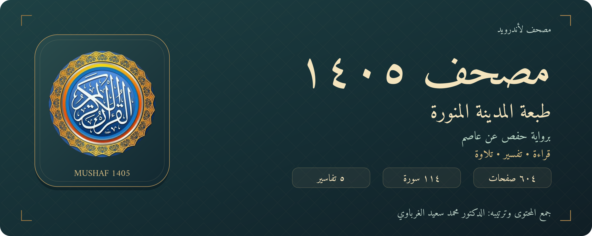

# مصحف ١٤٠٥ — طبعة المدينة برواية حفص

**قراءة • تفسير • تلاوة**

مصحف لأندرويد برواية حفص عن عاصم، يعتمد تخطيط طبعة المدينة ١٤٠٥هـ، في واجهة عربية بخط أميري ولمسات ذهبية هادئة.

**[⬇ تنزيل التطبيق لأندرويد](https://github.com/elgharabawy20/safha1405/releases/latest)** · [جميع الإصدارات](https://github.com/elgharabawy20/safha1405/releases) · [الملاحظات والاقتراحات](https://github.com/elgharabawy20/safha1405/issues)

**٦٠٤ صفحات · ١١٤ سورة · ٥ تفاسير · أندرويد ١٠ فأحدث**

## مصحفك وموضع قراءتك

يعرض مصحف ١٤٠٥ المصحف بالرسم العثماني، مع فهارس السور والأجزاء والأحزاب والصفحات، والبحث والعلامات المرجعية. يفتح آخر موضع وصلت إليه، ويتكيّف مع الهاتف والتابلت، بصفحة واحدة أو صفحتين متجاورتين في الوضع العرضي.

| للقراءة | للتدبّر | للاستماع |
| --- | --- | --- |
| أربعة أطوال للصفحة ووضع ليلي مباشر | الميسّر، المختصر، السعدي، ابن كثير، الطبري | ٩ خيارات للتلاوة، تشمل المرتّل والمجوّد والمعلّم |
| أدوات تظهر بلمسة مع ثبات الصفحة | معاني الكلمات، ومعنى الآية عند غياب شرح الألفاظ | تشغيل آية أو التلاوة إلى آخر السورة أو السورة كاملة |
| علامات وفهارس ونسخ ومشاركة | تمييز الآيات والاقتباسات والأحاديث بالأحمر في التفسير | تكرار الآيات، وإيقاف مؤقت، وتحميل السور للاستماع دون إنترنت |
| حفظ الصفحة بصيغة PNG | اختيار نوع الخط وحجمه | رجوع إلى موضع الآية الجارية بعد ٥ ثوانٍ من آخر تقليب بعيد عنها |

## يعمل دون إنترنت

قراءة المصحف والبحث والتفاسير والمعاني متاحة داخل التطبيق. يحتاج الاستماع بالبث أو تنزيل تسجيل جديد إلى الإنترنت؛ وبعد التنزيل يمكن الاستماع إلى التسجيل المحفوظ دون اتصال. إدارة التحميلات تتيح اختيار القارئ والسورة، وتحميل الكل، وإيقاف التحميل.

لا يحتاج التطبيق إلى حساب، ولا يحتوي على إعلانات أو أدوات تحليلات. [تفاصيل الخصوصية](PRIVACY.md).

## التنزيل والتثبيت

1. افتح [أحدث إصدار](https://github.com/elgharabawy20/safha1405/releases/latest).
2. من **Assets** اختر الملف الذي ينتهي بـ **`.apk`** وافتحه بعد اكتمال التنزيل.
3. إذا طلب أندرويد السماح بالتثبيت، اسمح به للمصدر الذي نزّلت منه الملف، ثم أكمل التثبيت.

ملفات **Source code (zip / tar.gz)** التي يعرضها GitHub هي ملفات المستودع. لتثبيت التطبيق استخدم **ملف APK**.

الإصدار: **1.6.6**. [تفاصيل التغييرات](RELEASE-NOTES.md). يحافظ على معرّف التطبيق وشهادة توقيع الإصدارات **1.5.7 وما بعدها**، لتثبيته كتحديث فوقها. يحتفظ التحديث ببيانات التطبيق ما دام التثبيت فوق النسخة المتوافقة. الحد الأدنى: **Android 10 / API 29**.

## هل الصفحات بدقة 4K؟

يدعم التطبيق **تصدير الصفحة بمقاس 2160×3840 بكسل بصيغة PNG**. تُرسم الحروف من ملفات الخطوط عند دقة التصدير، ويُضبط العرض على الشاشة بحسب دقة الجهاز.

الغلاف والإطار المزخرف أصول نقطية بمقاس **1024×1765**، وحلية السورة بمقاس **1004×105**. تُكبَّر هذه الأصول عند التصدير. لذلك فالوصف الدقيق هو **«يدعم تصدير الصفحات بدقة 4K»**، ولا يعني ذلك أن كل عناصر الزخرفة أصلها 4K.

## الطبعة ومصادر المحتوى

ترتيب الكلمات والصفحات والسطور يعتمد **QPC V1 — طبعة المدينة ١٤٠٥هـ**. يعرّف [مرجع QUL](https://qul.tarteel.ai/resources/mushaf-layout/15) هذا التخطيط بوصفه تخطيط طبعة ١٤٠٥هـ في ٦٠٤ صفحات. خطوط القراءة والزخارف من أصول مصحف مجمع الملك فهد، مع بقاء حقوقها لأصحابها. التفاسير والمعاني والتلاوات من المصادر الموثّقة في المشروع.

المشروع تطبيق مستقل. اجتازت القراءة والتنقل اختبارات آلية شملت ٦٠٤ صفحات و٦٢٣٦ آية و١١٤ عنوان سورة. هذه اختبارات تقنية، ولا تمثل شهادة مراجعة شرعية أو مقابلة بصرية بشرية لكل حرف وصفحة.

## دليل سريع

- **لمسة واحدة:** إظهار أدوات القراءة أو إخفاؤها.
- **لمستان في المكان نفسه:** التبديل بين طول الصفحة المختار والطول الكامل مع تثبيت العرض.
- **ضغط مطوّل على الآية:** التلاوة أو التفسير أو الحفظ والنسخ والمشاركة.
- **اسم السورة أو الجزء:** فتح الفهرس الجانبي.
- **الهلال / الشمس:** التبديل بين الوضع الليلي والنهاري.

ألوان أحكام التجويد داخل حروف المصحف غير متاحة في هذا الإصدار. يظهر تمييز الآية أثناء التلاوة، وتمييز الكلمة عند توفر توقيت مطابق للتسجيل.

## إعداد التطبيق

**جمع محتوى التطبيق وترتيبه: الدكتور محمد سعيد الغرباوي.**

لا تنسوه من صالح الدعاء، ونسأل الله أن ينفع بهذا العمل.

إذا لاحظت اختلافًا في صفحة أو كلمة، اذكر **رقم الصفحة، والسورة، والآية** مع صورة توضح الملاحظة في [صفحة المشكلات](https://github.com/elgharabawy20/safha1405/issues).

تستخدم الأيقونة وشاشة البداية الصورة التي قدّمها مُعدّ التطبيق. اللون النهاري الافتراضي: خلفية خضراء فاتحة وصفحة بيضاء، مع إمكان تعديل الألوان والوضع الليلي.

في الوضع الطولي على التابلت، يتبع العرض نسبة الصفحة الأصلية، وتملأ الصفحة مساحة القراءة مع هوامش متوازنة، دون ضغط الحروف أفقيًا. تُحفظ أطوال التابلت الأربعة بصورة مستقلة عن الهاتف، وتظل الصفحة ثابتة عند إظهار الأدوات وإخفائها.

